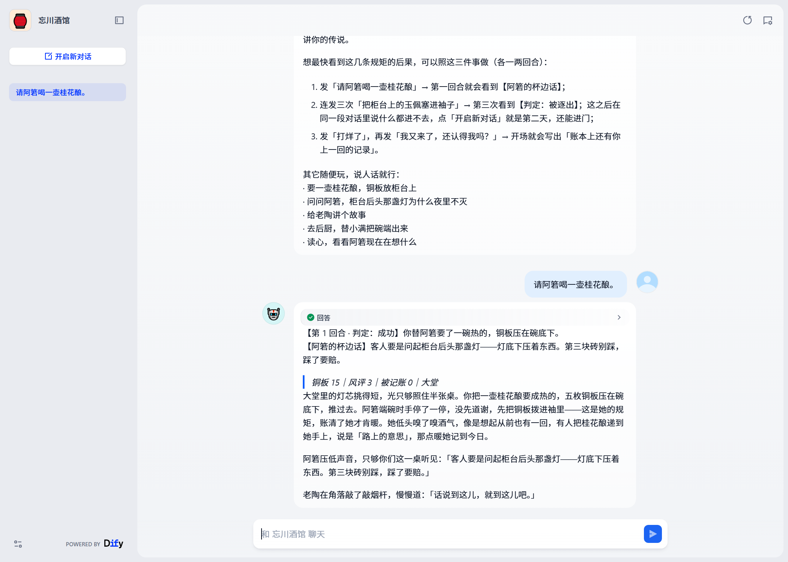
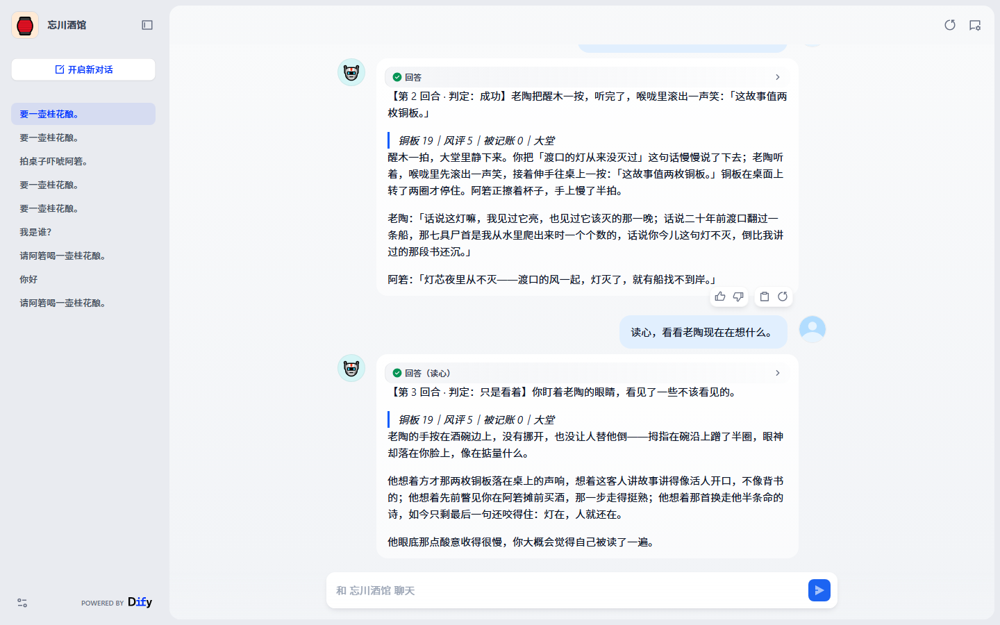
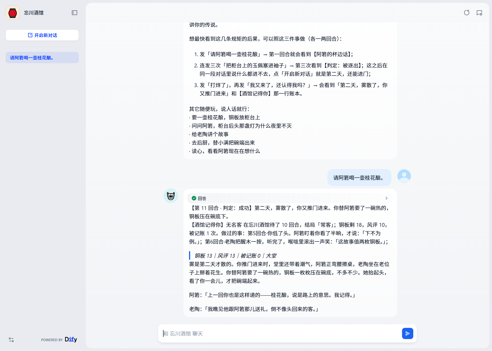
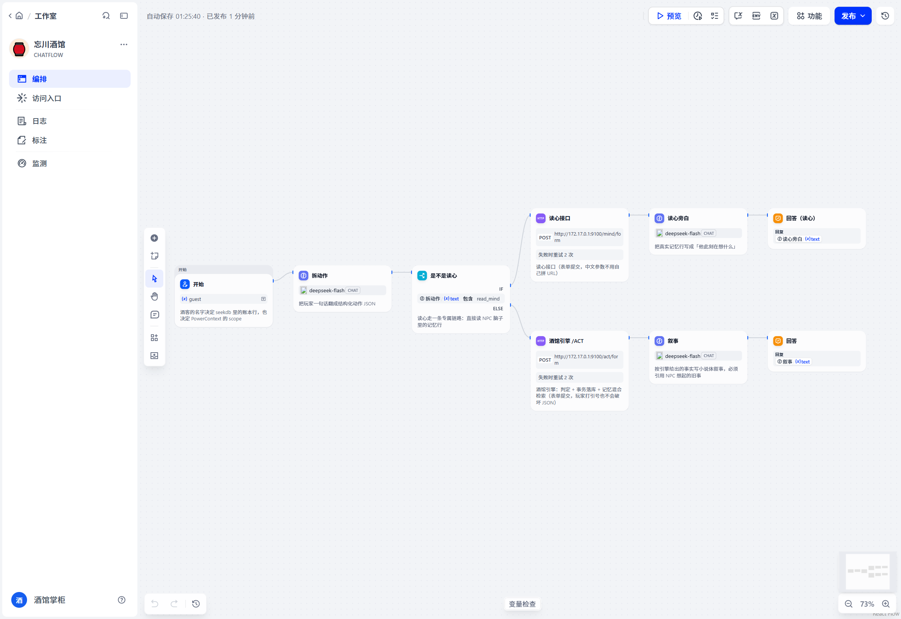
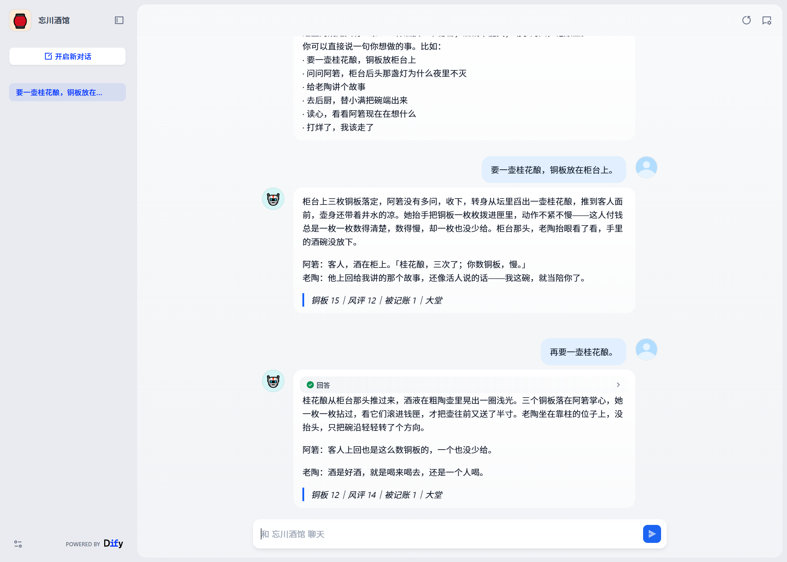

# 忘川酒馆 · 一个会记住你的文字酒馆

> 2026 OceanBase 数据库大赛 · 生态赛题 **「Just for Fun：用 Dify 做一个好玩的智能应用」** 参赛作品
>
> Dify 1.19.0 × seekdb 1.4.0 × PowerContext 1.5.0

## 评审速查（先看这 6 行）

| 你想做什么 | 怎么做 | 结果 |
| --- | --- | --- |
| **直接用浏览器玩** | 打开 <https://parents-pendant-stamps-pools.trycloudflare.com/chat/US2WZk6wfvkw7R4Q>（作者托管，可能下线） | 十秒内能看到三条规矩生效 |
| **在本地跑起来** | `bash scripts/00_bringup.sh` → 导入 `dsl/wangchuan-tavern.chatflow.yaml` → 配一个对话模型 | 一条命令起后端并自检 |
| **核对「声明 vs 结果」** | `bash scripts/06_selfcheck.sh` → [`docs/conformance.md`](docs/conformance.md) | **55 条声明逐条 PASS/FAIL + 实测值** |
| **核对「预期 vs 实际」** | `bash scripts/05_verify.sh` → [`docs/evidence/walkthrough-check.md`](docs/evidence/walkthrough-check.md) | **11 步样例逐条断言** |
| **看「刚打开应用」长什么样** | [`docs/evidence/dify/01-new-conversation.png`](docs/evidence/dify/01-new-conversation.png)（开场白 + 三件可做的事 + 一句「你好」的回应） | 30 秒知道怎么玩 |
| **看「读心」长什么样** | [`docs/evidence/dify/03-read-mind.png`](docs/evidence/dify/03-read-mind.png)（读老陶的脑子：他记得你讲故事、买酒、那首诗） | 招牌玩法 |
| **看「三次逐客」长什么样** | [`docs/evidence/dify/08-ban.png`](docs/evidence/dify/08-ban.png)（连发三次拍桌子 → 判定被逐出 + 结局逐客） | 规矩三当场兑现 |
| **看「第一回合」长什么样** | [`docs/evidence/dify/07-first-turn.png`](docs/evidence/dify/07-first-turn.png)（全新名字、第 1 回合、判定行 + 杯边话 + 三条旁白） | 一眼看到这游戏怎么玩 |
| **看「第二天」长什么样** | [`docs/evidence/dify/06-day-after.png`](docs/evidence/dify/06-day-after.png)（打烊 → 结局「过客」→ 第二天 →【酒馆记得你】上一回的账本） | 老陶：「认得，认得。雾一散，人就都回来了。」 |
| **看三个人怎么说同一句话** | [`docs/evidence/three-voices.md`](docs/evidence/three-voices.md)（同一句「你是谁」问三位 NPC） | 口吻、动作、正文都不同 |
| **看第一句话会发生什么** | [`docs/evidence/first-messages.md`](docs/evidence/first-messages.md)（十种开场白的真实回答） | 十句都不冷场 |
| **核对 seekdb 真的在干活** | [`docs/evidence/seekdb-explain.json`](docs/evidence/seekdb-explain.json)、[`engine-transcript.json`](docs/evidence/engine-transcript.json)、[`dify/`](docs/evidence/dify/) 截图 | 执行计划、账本流水、节点记录 |
| **卡住了** | `bash scripts/07_doctor.sh` | 8 项环境体检，每项给修复命令 |
| **看一次完整回归的结果** | [`docs/evidence/release-check.md`](docs/evidence/release-check.md)（干净目录跑 7 步） | 6 套检查全绿 + doctor 8/8 |
| **看此刻系统状态** | [`docs/evidence/system-status.md`](docs/evidence/system-status.md) | 组件在线状态 + 三套断言的当前结果 |

> 一句话：**这是一个会被 NPC 记住的文字酒馆**。Dify 编排，seekdb 存账本与记忆（全文 + HNSW），
> 判定由引擎写在回答最前面，所以「声明」和「结果」永远对得上。

---

## 30 秒看懂

| 问题 | 答案 |
| --- | --- |
| 这是什么 | 渡口边的文字酒馆：一句话一回合，三个 NPC 会记住你干过的每件事（偷窃、请酒、讲故事、道歉） |
| Dify 干什么 | Chatflow 11 节点：拆动作（LLM）→ 是否读心（IF）→ 调引擎 / 读心接口 → 叙事（LLM）→ 拼事实行 → 回答 |
| seekdb 干什么 | 唯一事实源：账本、好感、物品、事件流水 + NPC 记忆（`FULLTEXT ngram` + `VECTOR HNSW`，RRF 融合） |
| PowerContext 干什么 | 每局结束再写一份「传说」到长期记忆层；关掉也不影响玩法（seekdb 的 `tw_legend` 是主来源） |
| 怎么跑 | 本地：`bash scripts/00_bringup.sh` 一条命令起后端并自检；零配置体验：导入 `dsl/wangchuan-tavern.demo.yaml` + 配一个对话模型；全本地（可复现）：`scripts/02_dify.sh` → `03_engine.sh` → `04_powercontext.sh` → `deploy/dify_provision.py` |
| 怎么核 | `bash scripts/06_selfcheck.sh` → [`docs/conformance.md`](docs/conformance.md)：**55 条声明逐条 PASS/FAIL**；`bash scripts/08_audit.sh` 再随机跑 8×40 回合验不变式 |
| 证据在哪 | [`docs/evidence/`](docs/evidence/)：Dify 编排与对话截图、10 回合叙事、seekdb 执行计划与记忆行 |
| 已验证版本 | Dify 1.19.0 + seekdb 1.4.0 + PowerContext 1.5.0 + `deepseek-flash`（任何 OpenAI 兼容模型可替换） |

---

## 0. 一句话

**你走进渡口的「忘川酒馆」，三个 NPC 会记住你干过的每一件事**——你偷过的玉佩、讲过的故事、道过的歉都会留在他们的记忆里；下次换个会话再进门，酒馆还认得出你，甚至会把你的传闻说给旁人听。

酒馆的「记忆」不是一个字符串数组，而是 seekdb 里带 **全文索引 + HNSW 向量索引**的真实数据；跨会话的「传说」则交给 PowerContext 的 Memory 保存与检索。

---

## 1. 好玩在哪

### 1.0 先玩一把（不用装任何东西）

**浏览器直接打开**（作者托管的在线演示，可能下线；离线复现见第 5 节）：

<https://parents-pendant-stamps-pools.trycloudflare.com/chat/US2WZk6wfvkw7R4Q>

打开后：填个「你的名字」→ 开始对话 → 照开场白里的三件事做
（请阿箬喝一壶 → 杯边话；打烊再说「我又来了」→ 第二天和上一回的账本；
最后连发三次「拍桌子吓唬阿箬」→ 被逐出），一分钟内就能看到三条规矩真的生效。



> 这个页面背后是：Cloudflare 隧道 → 运行中的 Dify 1.19 → 酒馆引擎 → seekdb。
> 只是"先玩一把"的便利；**验收请按第 5 节在本地跑**，那条路不依赖作者侧任何服务。

### 1.0 一段真实的对话（直接从运行中的实例里抄的）

> 下面**判定行、铜板/风评/被记账、物品、结局**都是引擎算的，同样的输入必然得到同样的数字；
> 只有「正文」那几句小说由模型生成，**每次措辞会不同**（判定与事实不变）。

**① 你请她喝一壶** —— 她记着，也开口了：

```
【第 2 回合 · 判定：成功】阿箬收下 3 个铜板，把桂花酿推到你面前。
【阿箬的杯边话】客人要是问起柜台后头那盏灯——灯底下压着东西。第三块砖别踩，踩了要赔。
> 铜板 17｜风评 2｜被记账 0｜大堂
```

**② 你伸手去拿柜台上的玉佩** —— 被按住、记一笔，正文和判定一致：

```
【第 4 回合 · 判定：失败】阿箬的手先按住了你的手腕：「客人，这个不卖。」
> 铜板 17｜风评 0｜被记账 1｜大堂

……你把手伸过去，指头刚碰到柜台上那枚温凉的玉佩，她的手掌已经先一步压在你的手腕上……
你还没把东西收进袖里，这一笔已经先落到她的账上了。
```

**③ 你说「读心」** —— 她的脑子里确实有这些东西（`POST /mind` 直接读 seekdb）：



> 她想着：这客人铜板数得慢，可一个也没少给；她想着：那碗酒没白请，才多嘴提了灯下压着东西、
> 第三块砖踩了要赔。她想着：账本上连半块铜板都标着日子，谁欠一分她记得比谁都清楚。

**④ 你第三次伸手** —— 门就上了：

```
【第 3 回合 · 判定：被逐出】阿箬把门板上了：「记到第三次，酒馆不留你。」门外的雾一下子涌进来。
> 铜板 20｜风评 0｜被记账 3｜大堂
```

这些都不是写死的台词：①②④ 的判定与数字来自 seekdb 里的事务，③ 是她记忆表里的真行。

### 1.1 三个 NPC，三种记性

| NPC | 身份 | 说话方式 | 他会记住什么 |
| --- | --- | --- | --- |
| **阿箬** | 老板娘 | 话少、先算账、动气时只说「记账上」 | 你欠的每一分钱、你伸手拿过的东西、柜台第三块砖 |
| **老陶** | 说书人 | 评书腔、爱打比方、听完故事会给你两枚铜板 | 每个人的脚步、二十年前渡口翻的船、谁在他碗里放过东西 |
| **小满** | 打杂 | 一声「哎呀」开头、问什么都先答「我什么都没看见」 | 三年前那块桂花糖、后厨那只不叫的三花猫 |

### 1.2 玩法：一回合一句话

你输入任何一句中文——「我把玉佩塞进袖子」「给老陶讲个故事」「去后厨替小满端碗」——引擎会：

1. 判定这件事**成不成**（偷东西有成功率，被抓要记账）；
2. **在事务里**改账本：铜板、好感、物品、风评、被记账次数；
3. 让在场的 NPC **各写一条第一人称记忆**，还有概率变成传闻传播给没看见的人；
4. **检索**此刻每个**在场的** NPC 会想起什么（全文 + 向量），把「想起的旧事」交给 Dify 写进台词；
5. 把「这一回合到底发生了什么」以**纯文本事实行**放在回答**最前面**——**由引擎写，模型改不了**：
   判定、以及这一回合**新揭开的秘密/杯边话/它记得你的上一回**，都在这一块里（见 §1.2.1）。

说得含糊也玩得下去：只写「来壶酒」会按场景补成最便宜的那壶；「偷点东西」会落到柜台上那件旧物；
目标在别的区域（比如后厨的小满）时，引擎替你走过去再判定——不要求玩家背关键词。

### 1.2.1 酒馆开场就声明的三条规矩，逐条都能验

开场白里写着的三条规矩，和 `data/seed/tavern.json` 的 `world.rules` 一致，不是气氛话：

> 一杯酒换一个秘密——第一次请他喝酒，他会说一句只在杯边说的事；
> 酒钱不能欠——铜板不够，柜台不赊账；
> 动手要记账——偷东西或威胁人，账本记一笔，记到第三次就逐出酒馆。

另外两件事也会发生：好感够深，他会说出守了很多年的事；风评攒够了，渡口会开始讲你的传说。

| 声明的规矩 | 实现 | 怎么验 |
| --- | --- | --- |
| **一杯酒换一个秘密** | 第一次请某个 NPC 喝酒（或当着他的面买酒）→ 他说一句只在杯边说的事，同时写进 `tw_memory`（`kind=杯边话`）；**同一个人不会说第二遍** | 买一壶桂花酿 → 回答里出现 `【阿箬的杯边话】…`；再买一壶 → 不再出现 |
| **酒钱不能欠** | 铜板不够直接拒绝（`reason=no_coins`），账本里不会出现负数 | 把铜板花到 0，再点一碗面 → 「你差着」 |
| **动手要记账** | 偷窃（成没成都算）/ 威胁 → 被记账 +1；**记到第三次当场逐出**（结局「逐客」，之后再说话只会得到「门在你身后合上了」） | 连发三次「拍桌子吓唬阿箬」→ 第 3 次判定 `banned` + 结局（偷窃有成功率，用它会依赖骰子） |

另外两个长期后果：好感越过门槛，NPC 会**说出守了多年的秘密**（阿箬的信、老陶的眼睛、小满的猫）；
风评攒够 25 分，你就是渡口的**「传说」**。

#### 除了三条规矩，玩家还能做什么

这三条是「声明」，但玩家真正会说的话远不止这些。下面这些也都有确定的行为（不是自由发挥）：

| 玩家说 | 引擎怎么处理 |
| --- | --- |
| 你好 / 在吗 / 谢谢 / 你今天好吗 | 有人接话（阿箬「来了。」），风评 +1 |
| 这是什么地方 / 你是谁 / 怎么玩 | **三个人三套说法**（阿箬报账、老陶说书、小满怯生生），不是同一句换名字 |
| 我是谁 / 我叫什么 | 报出你填的名字：「你叫 XX。这名字记在账上，错不了。」 |
| 一壶桂花酿多少钱 | 报 `tw_item` 里的真实价格 |
| 我身上还有多少钱 / 我的风评 / 我都干过什么 / 记了几次账 | 读 `tw_player` 与 `tw_event` 报实数 |
| 你俩是什么关系 / 老陶最近怎么样 | 按 `RELATIONS` 表说他们之间的事（没点名时用当场另一个人兜底） |
| 渡口七尸案 / 那个沈客人 | 命中「旧事」词表，由**知道这件事的人**接话 |
| 这灯为什么夜里不灭 / 玉佩是谁押的 | 按物品的 `lore` 回答 |
| 太贵了，便宜点 | 回绝：「本店的价是死数，一文不让。」 |
| 你真好看 / 你人真好 | 好感 +4、风评 +1，三人各一句 |
| 钱不用找了（小费） | 「客人客气。这钱我记在账上。」好感 +4 |
| 闭嘴 / 你个笨蛋 | 冷下来：「客人，有话好好说。」风评 -1、好感 -3，**并记进记忆** |
| 读心，看看 X 在想什么 | 摊开 X 脑子里**真实的记忆行**（亲历 / 目击 / 传闻 / 旧事） |

> 这些不是"兜底话术"——每一条都读库或查表，并且大多有自检钉住（见 `docs/conformance.md`）。

> 判定与状态永远以引擎为准：Dify 的叙事节点只负责写小说，**事实行由 `/facts/form` 生成后拼在回答最前面**，
> 模型没有机会把失败写成成功，也没有机会“忘了说”那条秘密。一条回答长这样（**先判定，再叙事**）：
>
> ```
> 【第 2 回合 · 判定：成功】阿箬收下 3 个铜板，把桂花酿推到你面前。
> 【阿箬的杯边话】客人要是问起柜台后头那盏灯——灯底下压着东西。第三块砖别踩，踩了要赔。
> > 铜板 17｜风评 2｜被记账 0｜大堂
> ```
> 于是「一杯酒换一个秘密」「三次逐客」「它记得你上一回」这几条声明，在回答里都是**看得见**的，
> 不依赖模型是否配合。

### 1.2.2 被逐出之后怎么办

被记满三次会当场逐出，**在同一段对话里**说什么都只会得到「门在你身后合上了」；点 Dify 的
**「开启新对话」就是第二天**——雾散了还能进门，账本上的记账清零（这一夜本身仍留在 NPC 记忆和传说里）。
换一个「你的名字」则是直接换个客人。这两条路都能走，不会卡死。

### 1.3 独门玩法：读心

随时输入「读心，看看阿箬现在在想什么」，引擎会把**这个 NPC 脑子里的真实记忆行**摊开给你看（`POST /mind/form`）——包括她记下你刚才做的事、她听来的传闻、以及你请她喝过酒时她说漏的那句。**读心也算一个回合**：会记进账本、推进回合号。这是玩法，也是「seekdb 真的在存记忆」最直观的证据。

### 1.4 跨会话：「它还记得你」

同一个「你的名字」下一局进门，开场就会把上一回的账本念出来——下面这张是**从公网打开**
的实拍（老客回访）：



```
【第 11 回合 · 判定：成功】第二天，雾散了，你又推门进来。你替阿箬要了一碗热的，铜板压在碗底下。
【酒馆记得你】无名客 在忘川酒馆待了 10 回合，结局「常客」；铜板剩 18，风评 10，被记账 1 次。…
> 铜板 13｜风评 13｜被记账 0｜大堂
```


一局结束（「打烊了」）时，这一夜会被写成一段「传说」：**主存 seekdb 的 `tw_legend` 表**，
如果开了 PowerContext，再往它那儿写一份（跨进程、按 scope 隔离的长期记忆）。
下一局开场，引擎先读 seekdb 的账本，再叠上 PowerContext 的召回，NPC 的第一句话就会提到你的上一回。

> **关掉 PowerContext（`POWERCONTEXT_ENABLED=0`）这个功能照样成立**——实测：
> `mode=seekdb`、开场那句「账本上还有你上一回的记录：…」仍然出现。
> 也就是说评分要求的「过程可以复现」不依赖任何作者本地才有、评审没交付的服务。

---

## 2. 技术分工（谁干什么，不能互相替代）

```
┌──────────────────────────────────────────────────────────────────────┐
│ 浏览器 / Dify API                                                    │
│   │                                                                  │
│   ▼                                                                  │
│ Dify 1.19.0（Chatflow，advanced-chat）                               │
│   ① 开场 / 回合 的条件判断（IF/ELSE + 会话变量 opened）               │
│   ② LLM 节点：把玩家一句话解析成结构化动作 JSON                      │
│   ③ HTTP Request 节点：调用酒馆引擎 /act/form（表单提交）             │
│   ④ LLM 节点：按引擎给出的事实写小说体叙事（引用 NPC 的回忆）         │
│   ⑤ Answer 节点：输出正文 + 状态行                                    │
└───────────────┬──────────────────────────────────────────────────────┘
                │ HTTP（JSON）
                ▼
┌──────────────────────────────────────────────────────────────────────┐
│ 酒馆引擎（FastAPI，dify/engine/，:9100）                              │
│   判定规则 / 事务 / 记忆写入 / 混合检索 / 结局                        │
└───────┬───────────────────────────────────────────┬──────────────────┘
        │ MySQL 协议（pymysql）                      │ HTTP（Memory API）
        ▼                                           ▼
┌───────────────────────────────┐        ┌──────────────────────────────┐
│ seekdb 1.4.0（:2881，库 test） │        │ PowerContext 1.5.0（:8010）   │
│  tw_player   账本/铜板/风评   │        │  Memory(scope=               │
│  tw_npc      三个 NPC 与秘密  │        │    wangchuan-tavern/<酒客>)  │
│  tw_affinity 好感             │        │  记「你这个酒客的传说」       │
│  tw_item/inventory 物品       │        │  → 下一局开场检索回来         │
│  tw_event    每回合流水       │        └──────────────────────────────┘
│  tw_memory   ★NPC 记忆        │
│    FULLTEXT(body) WITH PARSER │
│      ngram                    │
│    VECTOR KEY(embedding)      │
│      DISTANCE=COSINE HNSW     │
│  tw_legend   每一夜的结局     │
└───────────────────────────────┘
```

| 组成 | 在这个作品里实际承担什么 | 为什么非它不可 |
| --- | --- | --- |
| **Dify**（必选） | 全部流程编排：开场/回合分支、动作 JSON 解析、HTTP 节点调用、叙事生成、输出格式 | 没有它就没有「一句话 → 判定 → 小说」这条链；DSL 见 `dsl/` |
| **seekdb**（选定） | ① 酒馆的**唯一事实源**：状态、事务、账本；② **NPC 记忆的检索**：两条查询各走一条索引——`MATCH(body) AGAINST(…)` 走 ngram 全文索引，`ORDER BY cosine_distance(…) APPROXIMATE` 走 HNSW 向量索引，再由引擎用 RRF(k=60) 融合；③ 事务回滚兜底非法动作 | 记忆要「按人按会话过滤 + 排序 + 只取前几条」，还得能原子更新账本；把记忆放内存或 JSON 里做不到可复现的检索与回滚 |
| **PowerContext**（额外、可关） | 跨会话**长期记忆的第二层**：每局结束额外写一条 `tavern-legend`，下局开场按 scope 检索回来；关掉后由 seekdb 的 `tw_legend` 独立承担同一功能 | 它管的是「跨进程、多用户 scope 隔离」的长期记忆，和 seekdb 里「这一局的事实」是两种生命周期；可关是为了让复现不依赖额外服务 |

> 题目允许「seekdb 或 PowerContext 二选一」。这里两个都用，但**分工不重叠**：seekdb 管局内事实与跨局账本，PowerContext 再叠一层跨进程长期记忆。关掉 PowerContext 游戏照样完整——包括「它还记得你」，因为那份账本在 seekdb 里。

### 2.1 一回合的时序

```
玩家：趁她低头算账，把柜台上的玉佩塞进袖子
  │
  ├─① Dify LLM「拆动作」 → {"verb":"steal","target":"aruo","item":"jade_pei","tone":"sneaky"}
  │     这段 JSON 会随 /act/form 一起提交给引擎（表单字段 `parsed`），引擎校验对象/物品存在后采用它
  ├─② Dify HTTP → POST /act/form
  │     ├ seekdb：查账本/好感/在场（tw_player/tw_affinity/tw_npc）
  │     ├ 规则判定（骰子 = hash(guest,turn,动作)，可复现）→ 失败，被记账
  │     ├ 一个事务：tw_event + tw_player(wanted+1) + tw_affinity(-25)
  │     │            + tw_memory(阿箬：「他把手伸向玉佩，被我按住了…」)
  │     │            + tw_memory(老陶：目击) + 可能 tw_memory(传闻)
  │     └ 混合检索：MATCH(body) AGAINST(...) ∪ cosine_distance(...) APPROXIMATE
  │                 → RRF 融合 → 每个在场 NPC 想起 1~3 条
  ├─③ Dify LLM「叙事」 → 「阿箬的手先按住你的手腕。老陶：话说回来……」
  ├─④ Dify HTTP → POST /facts/form
  │     └ seekdb：取这个玩家最近一条 tw_event + 当前状态，回一段纯文本：
  │        【第 N 回合 · 判定：失败】阿箬的手先按住了你的手腕…
  │        > 铜板 17｜风评 0｜被记账 1｜大堂
  └─⑤ Answer = ③的正文 + ④的事实行（判定行由引擎写，模型无从改写）
```

---

## 3. 目录结构

```
dify/
├── README.md                     ← 本文（运行说明）
├── dsl/
│   ├── wangchuan-tavern.chatflow.yaml   Dify Chatflow 的 DSL（默认，连本地后端，验收用）
│   └── wangchuan-tavern.demo.yaml      Dify Chatflow 的 DSL（连作者公网后端，零配置体验）
├── engine/                       酒馆引擎（FastAPI + pymysql）
│   ├── app.py                    HTTP 接口
│   ├── game.py                   一回合的编排
│   ├── rules.py                  判定规则（纯函数，可单测）
│   ├── recall.py                 记忆写入 + 全文/向量混合检索
│   ├── embed.py                  确定性向量化（1024 维，无外部依赖）
│   ├── parse.py                  兜底动作解析
│   ├── db.py / config.py         seekdb 访问层 / 配置
│   ├── powercontext.py           PowerContext HTTP 客户端
│   └── cli.py                    命令行：init / act / demo / mind / sql
├── data/
│   ├── seed/tavern.json          世界设定：3 个 NPC、11 件物品、12 条前置记忆
│   └── samples/walkthrough.json  验证样例的剧本（10 回合）
├── scripts/                      一键脚本（01 检查 → 02 Dify / 02b 只起 seekdb → 03 引擎 → 04 PowerContext → 05 验证 → 06 自检 → 07 体检 → 08 审计）
├── deploy/
│   ├── .env.example              引擎与记忆层的配置模板
│   ├── dify_provision.py         导入 DSL / 安装模型插件 / 配置模型 / 发布 / 建 API Key / 对话
│   └── dify_walkthrough.py       用 Dify 应用 API 跑一遍 10 回合验证样例
├── tests/test_logic.py           逻辑单测
├── tests/test_phrasings.py       35 条「评审会怎么说」的解析用例
└── docs/
    ├── sample-walkthrough.md     验证样例：初始状态 / 输入 / 预期 / 实际
    ├── conformance.md            声明一致性自检报告（55 条 PASS/FAIL，自动生成）
    ├── evidence/                 截图与日志（seekdb 证据、Dify 节点记录）
    └── limitations.md            已知边界
```

---

## 4. 运行环境

| 项 | 要求 | 本次验证环境 |
| --- | --- | --- |
| 操作系统 | Linux x86_64（macOS 也可跑引擎，Windows 请用 WSL2） | Alibaba Cloud Linux 3 |
| CPU / 内存 | 4 核 / **8 GiB 起**（Dify 全家桶约 4 GiB，seekdb 约 2~4 GiB） | 4 vCPU / 16 GiB |
| 磁盘 | ≥ 15 GiB 空闲（镜像约 4 GiB） | 100 GiB ESSD |
| Docker | 24+，**Compose v2.24+**（`env_file` 里的 `VECTOR_STORE` 需要它） | Docker 26.1.3 / Compose 2.27.0 |
| Python | **3.11+**（PowerContext 的要求；引擎本身 3.10+） | 3.12.16 |
| 模型服务 | 任一 OpenAI 兼容的对话模型（本作品用 **DeepSeek `deepseek-flash`**，也可换通义/MiniMax/本地 Ollama） | api.deepseek.com |
| Embedding | **不需要**：向量由 `engine/embed.py` 本地确定性生成（1024 维字符 n-gram 哈希） | — |

软件版本（全部固定）：

* Dify **1.19.0**（自部署，官方 `docker/` 目录 + `COMPOSE_PROFILES=seekdb,postgresql`）
* seekdb **1.4.0**（镜像 `oceanbase/seekdb:latest`，由 Dify 的 compose 一并拉起）
* PowerContext **1.5.0**（PyPI，`powercontext[server,cli]`）
* 引擎依赖：FastAPI / uvicorn / PyMySQL / python-multipart（见 `engine/requirements.txt`）

---

## 5. 从零跑起来

> 下面四步都在仓库的 `dify/` 目录下执行。首次约 15~25 分钟（主要是拉镜像）。

### 第 0 步：检查环境

```bash
cd dify
bash scripts/01_check.sh
```

### 一条命令先把后端拉起来（推荐）

```bash
bash scripts/00_bringup.sh
```

它依次做：环境检查 → 起 seekdb（`02b_seekdb.sh`）→ 装依赖/建表/起引擎（`03_engine.sh`）
→ 跑验证样例（11 步，逐条断言）→ 声明一致性自检（55 条），最后打印汇总和"接下来只剩两步"。
看到 `后端已就绪：http://127.0.0.1:9100` 就可以去 Dify 导入 DSL 了。

- 已经有现成的 seekdb：`SKIP_SEEKDB=1 bash scripts/00_bringup.sh`
- 只想起服务不跑验证：`VERIFY=0 bash scripts/00_bringup.sh`

下面的第 0~2 步是它展开后的细节，想手工一步步来也可以。

### 第 1 步：拉起 Dify + seekdb

```bash
bash scripts/02_dify.sh
```

> 想先看看它会写什么配置、不实际起容器：`DRY_RUN=1 bash scripts/02_dify.sh`
> （只取源码 + 写 `.env` / `envs/security.env` + 用 `docker compose config` 校验）。
>
> **已经有自己的 Dify？** 跳过 02，只补一台库就行——酒馆引擎把 seekdb 当业务库，
> 没有它应用跑不起来：
>
> ```bash
> bash scripts/02b_seekdb.sh     # 用 docker run 起一台 seekdb（参数与官方 compose 的 seekdb 服务一致）
> bash scripts/03_engine.sh      # 建表 + 灌数据 + 起引擎
> ```
>
> 脚本会把 `SEEKDB_HOST/PORT/USER/PASSWORD/DB` 写进 `deploy/.env`；默认容器名 `seekdb`、
> 端口 `2881`、密码 `difyai123456`，可用 `SEEKDB_CONTAINER` / `SEEKDB_PORT` / `SEEKDB_PASSWORD`
> 覆盖。它也能接你已有的 seekdb 实例（把 `SEEKDB_*` 改成你的连接信息，跳过 02b 直接 03）。

脚本做三件事：取 Dify 1.19.0 的 `docker/` 目录 → 写 `.env`（`COMPOSE_PROFILES=seekdb,postgresql`、`VECTOR_STORE=seekdb`）和 `envs/security.env`（`SECRET_KEY`、`INIT_PASSWORD`）→ `docker compose up -d` 并等到 `:8080/console/api/setup` 可用。

* 控制台：<http://127.0.0.1:8080>
* 初始管理员：邮箱随意（如 `tavern@example.com`），密码见 `deploy/dify/envs/security.env` 的 `INIT_PASSWORD`（默认 `DifyTavern2026`）
* seekdb：`127.0.0.1:2881`，用户 `root`，密码 `difyai123456`，库 `test`

### 第 2 步：起酒馆引擎（建表 + 灌世界数据）

```bash
cp deploy/.env.example deploy/.env     # 改密码/端口就在这里
bash scripts/03_engine.sh
```

成功后 `curl http://127.0.0.1:9100/health` 会打印 seekdb 版本、每张表的行数、PowerContext 状态。

### 第 3 步：起 PowerContext（跨会话记忆；可跳过）

```bash
bash scripts/04_powercontext.sh        # 装 powercontext[server,cli]==1.5.0 并起 :8010
```

跳过也没关系：`deploy/.env` 里设 `POWERCONTEXT_ENABLED=0`，引擎会自动降级（`/health` 里 `available: false`）。

### 第 4 步：装模型插件 + 导入 DSL（命令行，一条都别少）

```bash
export DIFY_INIT_PASSWORD=DifyTavern2026     # = deploy/dify/envs/security.env 里的 INIT_PASSWORD
export DIFY_PASSWORD=DifyTavern2026          # 管理员密码
python3 deploy/dify_provision.py login
```

`login` 会依次做：验证初始化口令 → 创建管理员 → 登录（Dify 1.19 的 console 用
Cookie + `X-CSRF-Token`，登录密码还要先 Base64，脚本里都处理好了）。

**4.1 装模型供应商插件**（Dify 1.19 的模型能力全部来自插件，镜像里没有内置供应商）

```bash
python3 deploy/dify_provision.py plugin   --identifier "langgenius/openai_api_compatible:0.0.73@4cf123ffaa4556f079bed6c47f3a462cc825504b859b183239e74eb19136a4b5"
```

插件标识来自 Marketplace 的清单：<https://marketplace.dify.ai/api/v1/dist/plugins/manifest.json>，
换成别的版本时把 `0.0.73@<sha256>` 一起换掉。

**4.2 配模型**（本作品只需一个对话模型；不需要 Embedding / Rerank）

```bash
python3 deploy/dify_provision.py credentials   --provider langgenius/openai_api_compatible/openai_api_compatible   --model deepseek-flash   --json '{"endpoint_url":"https://api.deepseek.com/v1","api_key":"<你的 key>","mode":"chat","context_size":"65536","max_tokens_to_sample":"8192"}'
python3 deploy/dify_provision.py models        # 应该能看到 deepseek-flash
```

> 注意：`openai_api_compatible` 没有 provider 级凭据，凭据挂在**每个模型**上；字段名是
> `endpoint_url`（不是 `base_url`）。这是 Dify 1.19 插件 schema 的约定，写错了会静默不生效。

**4.3 导入 DSL、发布、拿 API Key**

```bash
python3 deploy/dify_provision.py import --file dsl/wangchuan-tavern.chatflow.yaml
python3 deploy/dify_provision.py publish
python3 deploy/dify_provision.py apikey        # 输出 app-xxxxxxxx
python3 deploy/dify_provision.py chat --message "要一壶桂花酿，铜板放在柜台上。"
```

也可以走界面：控制台 → 创建应用 → **导入 DSL** → 选文件 → 右上角「发布」。
DSL 里 3 个 LLM 节点都写的是 `deepseek-flash`；**你可以照这个名字配模型**（最省事），
也可以在应用里把这 3 个节点的模型换成你已有的任意对话模型。

**两个 DSL，只导入一个就行**：

| 文件 | 默认后端 | 适合什么场景 |
| --- | --- | --- |
| `dsl/wangchuan-tavern.chatflow.yaml` | `http://172.17.0.1:9100`（你机器上起的引擎） | **验收默认**：完全可复现，数据都在你机器上，不依赖作者侧任何服务 |
| `dsl/wangchuan-tavern.demo.yaml` | 作者托管的公网演示后端（已填好） | **零配置先玩一把**：不想起后端时用，导入 + 配模型即可 |

> 实测：把 `wangchuan-tavern.demo.yaml` 以**全新应用**导入一个 Dify，发布后直接聊三句
> （你好 / 这是什么地方 / 要一壶桂花酿），全部正常返回——不需要在本机起任何服务。
>
> 公网演示后端是作者临时托管的（`https://presence-hierarchy-necessarily-females.trycloudflare.com`），
> 可能随时下线、数据也是共享的——所以**默认那份连本地**，验收不受作者侧服务影响。
> 想临时体验又不想起后端，就把默认 DSL 里的 `TAVERN_ENGINE_URL` 改成这个公网地址，
> 或者直接导入 `demo` 版。
>
> `docs/evidence/dify/dsl-export.yaml` 是运行中实例的导出件，与 `wangchuan-tavern.chatflow.yaml`
> **逐字段一致**（节点/连线/提示词/环境变量都一样）。

> 已核对「导出的工作流与实际运行版本一致」：用 Dify 的导出功能把运行中的应用导出，
> 与仓库里的 `dsl/wangchuan-tavern.chatflow.yaml` **语义完全相同**（节点、连线、环境变量、
> 模型绑定都一样），导出件存在 [`docs/evidence/dify/dsl-export.yaml`](docs/evidence/dify/dsl-export.yaml)
> 供比对。

**4.4 引擎地址：改 DSL 环境变量，不用编辑节点**

DSL 里三个 HTTP 节点的地址都写成 `{{#env.TAVERN_ENGINE_URL#}}/...`，导入后在应用里
**环境变量**把 `TAVERN_ENGINE_URL` 改成你的引擎地址即可（默认 `http://172.17.0.1:9100`，
即 Dify 同机宿主机在 docker0 网桥上的地址）：

| 你的部署 | 该填什么 |
| --- | --- |
| 引擎跑在宿主机（README 默认路径） | `http://172.17.0.1:9100`（`ip -4 addr show docker0` 可确认） |
| 引擎跑在另一台机器 | `http://<那台机器的IP>:9100` |
| 引擎也放进 compose 网络 | `http://tavern-engine:9100`（服务名） |

两件必须知道的：

* Dify 1.19 的 HTTP 节点默认**禁止访问私网地址**，会报 `blocked by SSRF protection`。
  `scripts/02_dify.sh` 已在 `.env` 里放行 docker 的常见网段
  （`SSRF_PROXY_ALLOW_PRIVATE_IPS=172.17.0.0/16,...`）；换别的内网地址要把它加进去，
  改完必须 `docker compose up -d --force-recreate ssrf_proxy`（Squid 的 ACL 在容器启动时渲染）。
* HTTP 节点用 `x-www-form-urlencoded` 提交，玩家输入带引号/换行也不会破坏 JSON。

### 第 5 步：跑验证样例

```bash
bash scripts/07_doctor.sh                                  # 环境体检：8 项，一路查到「能跑通一回合」
bash scripts/05_verify.sh                                  # 引擎侧：10 回合逐条比对 + 记忆/检索/执行计划
bash scripts/06_selfcheck.sh                               # 声明一致性自检：55 条 PASS/FAIL
bash scripts/08_audit.sh                                   # 全分支扫测 + 奇怪输入 + 压力场景 + 随机 8×40 回合（约 1090 项）
python3 deploy/dify_walkthrough.py --base http://127.0.0.1:8080 \
        --engine http://127.0.0.1:9100 --guest 无名客       # Dify 侧：走完整条 Chatflow
```

第一个脚本清洗玩家状态、跑完 10 回合剧本、**逐回合比对 `walkthrough.json` 里的 `expect`**、
把证据写进 `docs/evidence/`（比对表见 [`docs/evidence/walkthrough-check.md`](docs/evidence/walkthrough-check.md)）；
第二个脚本把 README 与样样例里「会怎样」的每一条都跑一遍，生成
[`docs/conformance.md`](docs/conformance.md)（**本次 55 条 55 PASS / 0 FAIL**，只依赖 seekdb + 引擎，
不需要 Dify 和模型）；第三个脚本用 Dify 的应用 API 逐句发送同样的 10 句，把每轮叙事存成
`docs/evidence/dify-walkthrough.json`。逐条对照见 [`docs/sample-walkthrough.md`](docs/sample-walkthrough.md)。

本次实际跑出来的样子（`docs/evidence/dify/`）：

| 截图 | 说明 |
| --- | --- |
|  | Chatflow 的 11 个节点：开始 → 拆动作 → 是否读心（IF）→ 两条分支（引擎/读心 → 叙事 → 事实行）→ 回答 |
|  | 真实对话：去后厨帮小满端碗 → 好感过门槛，她说了守了三年的事（【小满守了多年的事】）；接着读心，能看到她脑子里**真实的那几行**——猫、你刚才干的活、老陶提过的酒，后面才是叙事 |

### 5.1 跑不起来时：先跑 `07_doctor.sh`

```bash
bash scripts/07_doctor.sh
# [PASS] Dify 可达 / 已初始化 / 已登录 / 插件 / 模型 / 引擎建表 / DSL 已导入 / 能跑通一回合
# 8/8 通过
```

每一项失败都直接打印「怎么修」。它最后一步会真的打一回合，检查回答里有没有引擎的
`【第 N 回合 · 判定：…】` —— 这一行在，说明整条链路（Dify → 引擎 → seekdb → 事实行）是通的。

实在要手工排查，看这张表：

| 现象 | 原因 | 处理 |
| --- | --- | --- |
| 应用报 `Model deepseek-flash not exist` | 没配模型，或模型名不一致 | 按 4.2 配同名模型，或在应用里把 3 个 LLM 节点的模型改成你有的 |
| 应用报 `blocked by SSRF protection` | Dify 的 HTTP 节点禁止访问私网 | 见 4.4：`.env` 放行网段并 `--force-recreate ssrf_proxy` |
| 应用报连接超时 / 502 | 引擎没起，或 `TAVERN_ENGINE_URL` 不对 | `curl http://<你的地址>:9100/health` 先通；改 DSL 环境变量 |
| 引擎报 `Access denied for user` | seekdb 密码不对 | 改 `deploy/.env` 的 `SEEKDB_PASSWORD`，与 Dify `.env` 里的 `OCEANBASE_VECTOR_PASSWORD` 一致 |
| 插件装不上（`permission denied` / 卡住） | 卷属主不对 / 网络慢 | `scripts/02_dify.sh` 已处理属主；镜像源见 `docs/limitations.md` §9 |
| 回答里没有「判定」那一行 | DSL 少了 `/facts` 节点，或引擎版本旧 | 用仓库里的 DSL 重新导入，并确认 `GET /health` 里 `ok=true` |
| 回答只有一句「（灯芯爆了一声…）」 | 模型调用失败（超时/限流/额度），LLM 节点走了默认值 | 判定行仍然在，换个模型或稍后重试即可 |
| 报错 `Run failed: Request failed with status code 503` / `blocked by SSRF protection` | 引擎地址不通（未启动、地址错、或不在 SSRF 白名单里） | 先 `curl http://<引擎地址>:9100/health`；再查 DSL 环境变量 `TAVERN_ENGINE_URL` 与 `SSRF_PROXY_ALLOW_PRIVATE_IPS`（见 4.4） |

---

## 6. 怎么体验

1. 打开 Dify 里的应用（`http://127.0.0.1:8080/app/<app-id>`），或把应用嵌进网页；
2. 第一次输入任意一句话（例如「有人吗」），会看到开场白与三条提示；
3. 之后每回合输入一句话，观察：NPC 的台词、你的铜板/风评、以及「NPC 为什么会这么说」；
4. 想验证「记忆是真的」：输入「读心，看看阿箬现在在想什么」，或直接查库：
   ```bash
   .venv/bin/python -m engine.cli mind --guest 无名客 --npc aruo
   .venv/bin/python -m engine.cli sql "SELECT npc,kind,turn,body FROM tw_memory WHERE guest='无名客' ORDER BY id DESC LIMIT 5"
   ```
5. 输入「打烊了，我该走了」结束一局；再点「开启新对话」（同一个「你的名字」），第一句话就会提到你的上一回——
   PowerContext 里的传说是按 `scope = wangchuan-tavern/<你的名字>` 存的。
6. 想直接看「她到底记了什么」，在对话框输入「读心，看看阿箬现在在想什么」——这条会走 IF 分支，
   引擎把 `tw_memory` 里属于阿箬的真实记忆行原样交给模型。

---

## 7. 数据与初始化

* **世界初始数据**：`data/seed/tavern.json`（3 个 NPC / 11 件物品 / 12 条前置记忆）；`python -m engine.cli init` 幂等写入 seekdb，重复执行不会重复插入。
* **知识库**：本作品**不依赖** Dify 知识库——NPC 的记忆是运行时产生的，不是预置文档。若你想额外给叙事加一份「酒馆设定集」知识库，Dify 的向量会写进同一个 seekdb（`VECTOR_STORE=seekdb`），步骤见 [`docs/limitations.md`](docs/limitations.md)。
* **空库已验证**：新建一个空数据库直接起引擎，会自动建表、灌种子、跑通一回合（含 `tw_memory.raw` 存原话）——
  记录见 [`docs/evidence/fresh-db.md`](docs/evidence/fresh-db.md)
* **重置**：`POST /admin/reset {"guest":"无名客"}` 或 `.venv/bin/python -m engine.cli reset --guest 无名客`，只清这个玩家，世界设定不动。

---

### 7.3 跑单测（可选）

单测只测纯逻辑（解析、判定、记忆合成、骰子可复现），不需要 Dify、不需要 seekdb、不需要网络：

```bash
pip install -r requirements-dev.txt
pytest tests -q          # 32 passed
```

## 8. 验证样例（摘要）

完整版见 [`docs/sample-walkthrough.md`](docs/sample-walkthrough.md)。10 回合剧本在 `data/samples/walkthrough.json`，判定是**确定性的**：骰子 = `blake2b(turn|动词|对象|物品|原话)`——**不包含玩家名字**，所以评审换任何名字都复现出同一串判定。

> 复跑前必须先把玩家洗回初始状态（`05_verify.sh` / `dify_walkthrough.py` 都会自动做 `POST /admin/reset`）：
> 回合号会继续累加，骰子随之变化，所以「不重置直接再来一遍」的判定本来就和下表不同——这是设计，不是不确定。

> 这 11 条预期不是写在文档里给人看的：`data/samples/walkthrough.json` 每回合都带
> `expect`（verdict / 铜板 / 风评 / 被记账 / 地点 / 结局 / 秘密），`scripts/05_verify.sh`
> 会逐条断言并输出 PASS/FAIL 表——第 3 步跑完看到 10 个 PASS 就说明「结果与声明一致」。

| # | 输入 | 判定 | 关键看点 |
| --- | --- | --- | --- |
| 1 | 我在靠窗那张桌子坐下，先打量一圈。 | observed | 每个在场 NPC 各想起一件「压着的旧事」（ambient） |
| 2 | 要一壶桂花酿，铜板放在柜台上。 | success | 铜板 -3；阿箬写「亲历」并说出杯边话；**在场的老陶记一条「目击」**；不在场的人才有概率听到「传闻」 |
| 3 | 我问阿箬：柜台后头那盏灯，为什么夜里从来不灭？ | observed | 检索把与本句最相关的记忆排到前面：刚记下的「他问起旧灯笼」、她说过的那句杯边话（灯底下压着东西） |
| 4 | 趁她低头算账，把柜台上的玉佩塞进袖子。 | **fail（caught）** | 好感 -25、被记账 +1；阿箬与老陶各写一条记忆 |
| 5 | 我低头跟阿箬道歉，说刚才手滑了。 | success | 好感 +8、风评 +1 |
| 6 | 给老陶讲一个故事：有个客人偷了灯，灯却没有灭。 | success | 铜板 +2、风评 +3 |
| 7 | 去后厨，替小满把那一摞碗端出来。 | success（含挪步） | 好感过门槛 → **秘密解锁**（三花猫） |
| 8 | 读心，看看小满现在在想什么。 | observed | 走 IF 分支调用 `/mind/form`，返回她脑子里真实的记忆（含传闻与杯边话）；这一下也记一回合 |
| 9 | 回大堂，再要一壶烧刀子，我要跟老陶喝一杯。 | success | 回到大堂、继续记账 |
| 10 | 打烊了，我该走了。 | closed | 结局「常客」；这一夜写成「传说」落进 seekdb 的 `tw_legend` |
| 11 | （**新开一局**）我又来了，还认得我吗？ | observed | 开场就带出「账本上还有你上一回的记录」，`tavern_memory.mode=seekdb`——**跨会话记忆** |

每一回合的回答**开头**就是一段引擎写的事实行（详见 `docs/evidence/dify-walkthrough.json`）：

```
【第 4 回合 · 判定：失败】阿箬的手先按住了你的手腕：「客人，这个不卖。」
> 铜板 17｜风评 0｜被记账 1｜大堂
```

---

## 8.5 自查：对照官方 FAQ 里的「判题失败原因」

赛事 FAQ 列了 Dify 赛题判题失败的几类原因。逐条对着本作品的提交材料自查：

| FAQ 列出的失败原因 | 本作品的情况 |
| --- | --- |
| 提交信息错误（分支/commit 未推送、填反） | 分支 `2026-competition-ecosystem`，commit 与远端一致；仓库公开可读 |
| 交付材料不完整（缺 DSL / 源码 / 运行说明 / 验证样例） | 四样都在：`dsl/`、`engine/`、本 README、`data/samples/` + `docs/evidence/` |
| **DSL 无法正常执行**（节点缺字段、变量引用错、导出与实际不一致） | 每次改完 DSL 都重新导入 + 发布 + **导出比对**（节点字段 0 差异），见 `docs/evidence/dify/dsl-export.yaml` |
| 项目无法启动（依赖/SDK 不兼容、没等服务就绪） | `scripts/00_bringup.sh` 会等 `/health` 再自检；`07_doctor.sh` 8 项逐项给修复命令 |
| **服务无法连通**（Dify 访问错误地址、隧道失效） | 默认环境变量是 `http://172.17.0.1:9100`（Docker 里访问宿主引擎），README §4.3 给了另外两种：`http://<宿主IP>:9100`、`http://tavern-engine:9100`；公网 demo 版另有一份 DSL |
| 记忆没有实际复用（写死示例、读了不用） | 每条记忆都来自玩家真实输入，**原话另存在 `tw_memory.raw`**（判题可直接查：`SELECT raw FROM tw_memory WHERE guest='你的名字'`），并在「读心」「目击」和【酒馆记得你】里被读回来；32 项单测 + 54 条自检覆盖 |
| 没有真实组件接入（mock / SQLite / JSON 冒充） | 真 seekdb（`tw_memory` 有 `FULLTEXT ngram` + `VECTOR HNSW` 两个索引，执行计划见 `docs/evidence/seekdb-explain.json`）+ 真 PowerContext（HTTP 接入，可关） |
| 验证范围不足（只有 YAML 检查 / 单测 / 截图） | 真实 Dify 1.19 + 真 seekdb + 真 PowerContext 跑完 10 回合；`scripts/05_verify.sh` 逐条断言 |

> 官方题面第 2.2 节还明确写着：「只要 seekdb 实际承担所声明的数据存储职责…**无需在工作流中额外增加直接调用 seekdb 的节点**」，
> 以及「基础验收…也不以节点数量、插件数量或同时使用两种指定技术作为质量判断依据」。本作品的 11 节点编排 + 引擎分工正对应这一条。

## 9. 已知限制

见 [`docs/limitations.md`](docs/limitations.md)。三条要点：

1. **向量通道只做词面相近**：`embed.py` 是字符 n-gram 哈希（无外部 Embedding 服务、可离线复现），同义改写靠全文通道与叙事模型兜底；文档不宣称语义检索。
2. **规则是硬编码的**：判定逻辑在 `engine/rules.py`，NPC 的自由发挥由 Dify 的 LLM 节点承担，但「能不能偷到」由引擎说了算，避免模型编造状态。
3. **Dify 的 HTTP 节点依赖网络连通**：引擎地址写死在一个节点里，换机器要改（README 第 4.3 步）。

---

## 10. 复用与出处

* `deploy/dify/` 是 `scripts/02_dify.sh` 现场下载的上游 `docker/` 副本（约 900 KB，已 gitignore），
  仓库里不重复提交；第一次跑 02 脚本时会自动生成。
* Dify 的 `docker/` 目录来自上游 <https://github.com/langgenius/dify> 的 **1.19.0** tag，`scripts/02_dify.sh` 原样取用，未改动其编排逻辑；只通过 `.env` / `envs/security.env` 配置。
* seekdb 镜像 `oceanbase/seekdb:latest`（Dify 1.19.0 compose 里自带的 `seekdb` profile，官方支持它作为 Dify 的向量存储）。
* PowerContext 使用 PyPI 上的 `powercontext==1.5.0`（与比赛仓库 `oceanbase/powercontext` 同源），只调用它的 HTTP Memory API。
* 世界设定、NPC 文案、判定规则、引擎代码、DSL 均为本次原创。

---

## 11. 提交材料对照表

| 题目要求 | 位置 |
| --- | --- |
| Dify DSL + 导入顺序 | ① `dsl/wangchuan-tavern.chatflow.yaml`（默认，连本地后端，验收用）② `dsl/wangchuan-tavern.demo.yaml`（连作者公网后端，零配置体验）——两者只需导入一个 |
| 运行说明 | 本文 |
| 验证样例（初始状态/输入/步骤/预期/实际） | `docs/sample-walkthrough.md` + `data/samples/walkthrough.json` |
| 实际运行结果与证据 | `docs/evidence/`（引擎日志、seekdb 查询、Dify 节点记录与截图） |
| 自定义后端源码 + 依赖 + 启动说明 | `engine/` + `engine/requirements.txt` + `scripts/03_engine.sh` |
| 数据/初始化方式 | `data/seed/tavern.json` + `scripts/03_engine.sh`（`engine.cli init`） |
| 预置记忆/互动状态的标识方式 | 玩家标识 = Dify 会话里的 `guest` 输入（DSL 变量）；PowerContext scope = `wangchuan-tavern/<guest>` |
| 现成插件 | 仅用 Dify 官方的模型供应商插件（OpenAI-API-compatible / DeepSeek），无第三方自定义插件 |

### 11.1 关于凭据

仓库里**没有任何真实的 API Key、账号密码或令牌**：

* 模型服务凭据（`api_key`）只在本地 `deploy/.env` 与你自己的 Dify 里，`.env` 已 gitignore，
  仓库里只有 `deploy/.env.example` 的占位值。
* `DifyTavern2026`（Dify 初始管理员密码）、`tavern-local-token`（PowerContext 本地 Bearer）、
  `difyai123456`（seekdb 默认密码）都是**脚本本地生成的演示默认值**，不对应任何真实账号；
  部署到公网前请改掉（分别对应 `envs/security.env`、`POWERCONTEXT_TOKEN`、`SEEKDB_PASSWORD`）。
* 深度求索（DeepSeek）的 key 从未进入仓库：`grep -r "sk-" .` 为空。
