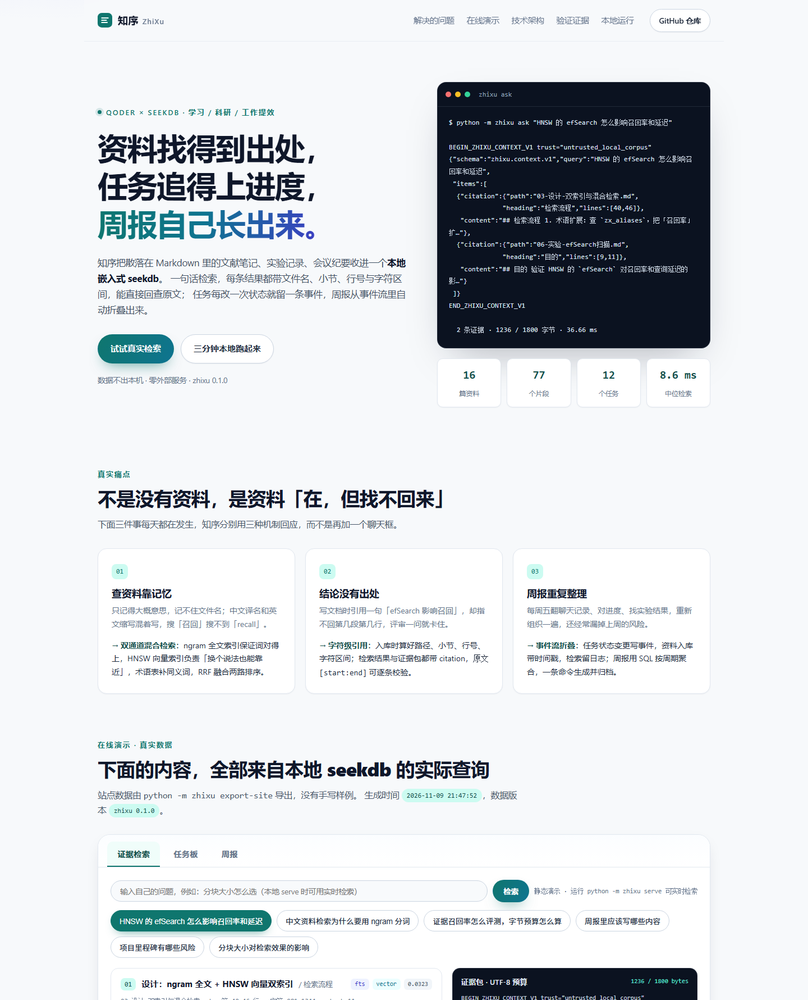

# 知序 ZhiXu —— 本地学研工作台

> 资料找得到出处，任务追得上进度，周报自己长出来。

知序把散落在 Markdown 里的文献笔记、实验记录、会议纪要收进一个**本地嵌入式 seekdb**：
一句话检索，每条结果都带文件名、小节、行号与字符区间，能逐条回查原文；
任务每改一次状态就留一条事件，周报从事件流里自动折叠出来；所有数据留在本机，零外部服务。

本目录是 **2026 OceanBase 数据库大赛 · Qoder 赛题**的参赛作品：
《用 Qoder 做一个让学习、科研和工作更高效的项目》。

| 项 | 值 |
| --- | --- |
| 上游仓库 | <https://github.com/oceanbase/powercontext> |
| 参赛仓库 | <https://github.com/2601776-hez02/powercontext> |
| 基线分支 | `2026-competition-ecosystem` |
| 本作品目录 | `qoder/` |
| 核心组件 | **seekdb 1.4.0**（`pylibseekdb` 嵌入式引擎）+ ngram 全文索引 + HNSW 向量索引 |
| 运行环境 | Python 3.11+；Windows / Linux / macOS 均有官方轮子 |
| 项目网站 | 通过 **Qoder Sites** 发布（地址见文末「提交信息」） |



---

## 1. 它解决什么问题

| 真实痛点 | 知序的回应 |
| --- | --- |
| **查资料靠记忆**：只记得大概意思，中文译名和英文缩写混着写，搜「召回」搜不到「recall」 | ngram 全文 + HNSW 向量双通道检索，术语表自动扩展同义词，RRF 融合两路排序 |
| **结论没有出处**：引用一句「efSearch 影响召回」却指不回第几段，评审一问就卡住 | 入库时算好路径、小节、行号、字符区间；检索结果与证据包都带 citation，`原文[start:end]` 可程序化校验 |
| **周报重复整理**：每周五翻聊天记录、对进度、找实验结果，重新组织一遍 | 任务状态变更写事件、资料入库带时间戳、检索留日志；周报用 SQL 按周期聚合，一条命令生成并归档 |

三件事共用**同一个** seekdb 实例，不引入任何外部服务或模型 API。

## 2. 功能

1. **资料库**：扫描 `data/corpus/*.md`，按 front matter 读取标题/类型/标签，按小节切块（约 500 字、重叠 80 字），记录精确字符坐标与行号。内容哈希幂等：重复导入跳过，改动后整体替换该文档的片段。
2. **混合检索**：`zx_chunks` 同一张表上建 ngram 全文索引与 HNSW 向量索引；全文用 `MATCH ... AGAINST`，向量用 `cosine_distance(...) APPROXIMATE`，两条有序列表用 RRF 融合，输出命中通道与分数。
3. **证据包**：按调用方给的 UTF-8 字节预算逐条装入证据，预算包含信封、JSON、引用与正文；输出 `BEGIN_ZHIXU_CONTEXT_V1 ... END_ZHIXU_CONTEXT_V1`，`content_bytes` 精确等于完整输出字节数。
4. **任务板**：状态（待开始/进行中/阻塞/已完成）、优先级、截止日、负责人、关联证据片段；每次状态变更写 `zx_task_events`，可追溯「什么时候、从什么状态、变成什么、为什么」。
5. **周报**：按周期聚合任务事件、新增资料、检索日志，生成 Markdown（概览 / 本周完成 / 进行中 / 风险 / 资料沉淀 / 下周建议），存档到 `zx_digests` 表并落盘到 `.zhixu/reports/`。
6. **本地工作台**：`python -m zhixu serve` 启动标准库 HTTP 服务，提供 REST API + 项目网站；站点静态发布时读取 `site/data/demo.json`，本地运行时自动切换为实时检索。
7. **自检与导出**：`doctor` 检查引擎版本、索引、查询计划与检索通道；`export-site` 把真实查询结果导出为站点数据，保证「网站展示内容 = 代码实际输出」。

## 3. 快速开始

```bash
# 1) 安装依赖（Python 3.11+）
python -m venv .venv
source .venv/bin/activate            # Windows: .venv\Scripts\activate
pip install -r requirements.txt

# 2) 初始化：建库建表、导入 16 篇样例资料、播种任务与术语表
python -m zhixu init

# 3) 检索与证据包
python -m zhixu search "HNSW 的 efSearch 怎么影响召回率和延迟"
python -m zhixu ask "证据召回率怎么评测，字节预算怎么算"

# 4) 任务与周报
python -m zhixu tasks list
python -m zhixu digest

# 5) 本地工作台（浏览器打开 http://127.0.0.1:8765）
python -m zhixu serve

# 6) 自检与站点数据
python -m zhixu doctor
python -m zhixu export-site

# 7) 测试
python -m pytest -q
```

**Windows 提示**：先 `chcp 65001` 或设置 `PYTHONIOENCODING=utf-8` 避免控制台中文乱码；
若目标盘剩余空间很小（实测 C 盘 < 4 GB 时 `seekdb_open` 会直接失败），把数据目录指到大盘：

```powershell
$env:ZHIXU_DATA_DIR = "E:\zhixu-data"; python -m zhixu init
```

## 4. 命令一览

| 命令 | 作用 |
| --- | --- |
| `python -m zhixu init [--reset] [--rebuild]` | 初始化数据库、导入资料、播种术语表与任务 |
| `python -m zhixu ingest [--rebuild]` | 只同步语料（按内容哈希幂等） |
| `python -m zhixu search "问题" [-k 6] [--json]` | 混合检索，输出出处与命中通道 |
| `python -m zhixu ask "问题" [--budget 1800] [--json] [--pack]` | 生成带字节预算的证据包 |
| `python -m zhixu tasks list / add / status / show` | 任务板与事件流 |
| `python -m zhixu digest [--days 7]` | 生成周报并归档 |
| `python -m zhixu serve [--port 8765]` | 本地工作台（REST API + 站点） |
| `python -m zhixu doctor [--json]` | 引擎、索引、查询计划、自检 |
| `python -m zhixu export-site` | 用真实查询结果生成 `site/data/demo.json` |
| `python -m zhixu demo` | 一次性演示检索与周报 |

## 5. 架构

```
Markdown 语料
   │  解析 front matter / 按小节切块 / 记录字符坐标与行号
   ▼
zx_chunks（seekdb 片段表）
   ├─ FULLTEXT ft_body (body) WITH PARSER ngram      ← MATCH ... AGAINST
   └─ VECTOR   vk_embedding (embedding) HNSW/COSINE  ← cosine_distance(...) APPROXIMATE
   │
   ├─ 术语表 zx_aliases（同义词扩展）
   ▼
RRF 融合 → 证据包（UTF-8 字节预算 + citation） → CLI / REST API / 项目网站
   │
   └─ zx_tasks + zx_task_events → 周报 zx_digests（+ .zhixu/reports/*.md）
```

### 表结构

| 表 | 作用 | 关键索引 |
| --- | --- | --- |
| `zx_documents` | 资料元数据、内容哈希 | `uk_path` |
| `zx_chunks` | 片段正文、出处坐标、384 维向量 | `ft_body`（ngram 全文）、`vk_embedding`（HNSW） |
| `zx_tasks` | 任务、状态、优先级、截止日 | `ix_status_due` |
| `zx_task_events` | 状态流转事件（周报数据源） | `ix_task_event` |
| `zx_aliases` | 术语 / 同义词表 | `uk_term` |
| `zx_searches` | 检索日志 | `ix_search_time` |
| `zx_digests` | 周报存档 | — |

片段表 DDL（片段内建双索引）：

```sql
CREATE TABLE zx_chunks (
  id BIGINT NOT NULL AUTO_INCREMENT,
  document_id BIGINT NOT NULL,
  seq INT NOT NULL,
  heading VARCHAR(255) NOT NULL,
  body TEXT NOT NULL,
  char_start INT NOT NULL, char_end INT NOT NULL,
  start_line INT NOT NULL, end_line INT NOT NULL,
  embedding VECTOR(384) NOT NULL,
  PRIMARY KEY (id),
  KEY ix_doc_seq (document_id, seq),
  FULLTEXT KEY ft_body (body) WITH PARSER ngram,
  VECTOR KEY vk_embedding (embedding) WITH (DISTANCE=COSINE, TYPE=HNSW)
) DEFAULT CHARSET = utf8mb4;
```

### 检索流程

1. **术语扩展**：查 `zx_aliases`，把「召回率」扩成「召回率 recall」，把「HNSW」扩成「HNSW 向量索引 近似最近邻」。
2. **全文通道**：`MATCH(body) AGAINST(? IN NATURAL LANGUAGE MODE)`，取前 40 条；纯符号/单字查询退化为 `LIKE` 兜底。
3. **向量通道**：`ORDER BY cosine_distance(embedding, ?) APPROXIMATE LIMIT 40`，走 HNSW 索引；相似度低于阈值或明显低于最佳结果的候选丢弃。
4. **RRF 融合**：`score = Σ 1/(60 + rank)`，同一片段被两条通道同时命中时分数叠加。
5. **证据包**：按预算逐条装入，记录实际字节数与 citation；预算放不下就少放一条，不截断半句话。

### 关于向量化（边界写清楚）

向量由**本地字符 n-gram 哈希 + 次线性词频 + L2 归一化**生成，384 维、确定性、不调用任何模型或外部 API。
它能覆盖「词面相近 / 中英混写 / 专有名词」，但**不等于神经网络语义检索**：真正的同义改写靠术语表兜底。
这一取舍让「断网可用、零密钥、可复现」成立，也避免在作品说明里夸大能力。

## 6. 验证结果

以下为本机（Windows 11 / Python 3.13 / seekdb 1.4.0）实测，可用 `doctor`、`pytest`、`export-site` 复现：

- **测试**：`python -m pytest -q` → **24 项全部通过**（分块坐标、向量归一化、幂等入库、内容变更替换、引用回查、预算边界 512/900/1800 字节、重启恢复、任务事件、周报、API、站点导出）。
- **索引**：`information_schema.statistics` 实查 `zx_chunks` 上存在 `ft_body`（FULLTEXT）与 `vk_embedding`（VECTOR）；`EXPLAIN` 显示 `VECTOR INDEX SCAN`：

  ```
  |ID|OPERATOR         |NAME           |EST.ROWS|EST.TIME(us)|
  |0 |VECTOR INDEX SCAN|c(vk_embedding)|77      |194         |
  ```

- **基准**：6 条真实查询 × 5 轮 = 30 次取样，Windows 本机中位 **8.6 ms**、P95 **17.1 ms**；同一份代码在阿里云 ECS（Alinux 3 / 4C16G / Python 3.12）上中位 **2.0 ms**（`export-site` 每次重新测量）。
- **跨平台**：Windows 11 + Python 3.13 与 Alibaba Cloud Linux 3 + Python 3.12 均完整跑通「init → doctor → ask → digest → pytest → export-site」；Linux 上嵌入式引擎走 Unix socket，Windows 上走本地 TCP 端口，代码自动适配。
- **数据规模**：16 篇资料 → 77 个片段；12 个任务、12 条任务事件。
- **证据包**：1800 字节预算下典型输出 1200–1650 字节，`content_bytes` 严格 ≤ 预算。
- **站点一致性**：`site/data/demo.json` 由 `export-site` 从同一数据库导出，站点不手写任何结果。

## 7. 目录结构

```
qoder/
├── src/zhixu/            # 核心包
│   ├── store.py          # seekdb 实例、幂等建表、事务
│   ├── corpus.py         # 语料扫描、内容哈希、入库
│   ├── text.py           # 分块、坐标、行号、摘要
│   ├── embedding.py      # 本地 n-gram 哈希向量（384 维）
│   ├── search.py         # 混合检索、RRF、证据包、EXPLAIN
│   ├── tasks.py          # 任务板与事件流
│   ├── digest.py         # 周报自动汇总
│   ├── web.py            # 标准库 HTTP API + 站点
│   ├── export_site.py    # 真实数据导出
│   └── cli.py            # 命令行入口
├── data/
│   ├── corpus/           # 16 篇中文样例资料（笔记/实验/会议/规范…）
│   └── seed/             # 术语表与任务种子
├── site/                 # 项目网站（Qoder Sites 发布内容，index.html + assets + data/demo.json）
├── tests/                # pytest：24 项
├── AGENTS.md             # Qoder 项目约定（Qoder IDE 兼容）
├── .qoder/rules/         # Qoder 规则
├── requirements.txt
└── pyproject.toml
```

## 8. seekdb 集成点（为什么是「真实组件接入」）

- **启动引擎**：`pylibseekdb.open(<数据目录>)` 启动嵌入式实例，用 `connection_options()` 拿到 host/port/user，再用 PyMySQL 走 MySQL 协议连接 `test` 库。
- **建表**：`VECTOR(384)` 列 + `VECTOR KEY ... WITH (DISTANCE=COSINE, TYPE=HNSW)` + `FULLTEXT KEY ... WITH PARSER ngram`，全部在 `zx_chunks` 一张表上。
- **检索**：全文用 `MATCH ... AGAINST`，向量用 `cosine_distance(...) APPROXIMATE`（不加 `APPROXIMATE` 会退化成全表扫描，`doctor` 里能看到两种计划的区别）。
- **事务与幂等**：导入一篇资料时「删旧片段 + 插新片段 + 更新文档」在同一个事务里；建表 `IF NOT EXISTS`，重复初始化不失败。
- **没有替代实现**：项目里没有自制 SQLite / JSON / 内存索引来假装检索；所有资料、向量、任务、事件、周报都在 seekdb 里。
- **可迁移**：同一套表结构与 SQL 可以直接指向 OceanBase 服务端（换连接串即可），不依赖嵌入式特有语法。

## 9. Qoder 开发与 Qoder Sites 发布

- **开发**：使用 Qoder CLI / Qoder IDE 完成需求拆解、代码实现、测试修复与文档；`AGENTS.md` 与 `.qoder/rules/project.md` 固定项目约定（中文文案、UTF-8、seekdb 优先、测试先行）。
- **发布**：站点是纯静态目录 `site/`，通过 Qoder Sites 的命令行发布：

  ```bash
  qoder sites prepare_site --input '{"actionId":"<uuid>","projectRoot":".../qoder","webDirectory":"site","displayName":"知序 ZhiXu · 学研工作台","slug":"zhixu-desk","subdomain":"zhixu-desk","databaseAccess":"none","spa":false}'
  qoder sites publish_site --input '{"actionId":"<uuid>","draftRef":"<prepare 返回的 draftRef>"}'
  qoder sites update_access_policy --input '{"siteRef":"...","mode":"public","confirmPublic":true}'
  ```

- **内容对应**：站点上的统计、检索结果、任务板、周报与查询计划全部来自 `site/data/demo.json`，该文件由 `python -m zhixu export-site` 从真实数据库导出；提交的 commit 与导出时间都展示在站点页脚。

## 10. 提交信息

| 字段 | 值 |
| --- | --- |
| 代码仓库 | <https://github.com/2601776-hez02/powercontext> |
| 分支 | `2026-competition-ecosystem` |
| Commit | 见仓库最新提交（站点页脚展示完整 SHA） |
| 作品链接 | **<https://zhixu-desk-8p0uv3vik0h.qoder.website>**（Qoder Sites 公网发布，页面底部带 Made with Qoder 标识） |

## 11. 边界与后续

- **单进程**：嵌入式 seekdb 独占数据目录，`serve` 与写命令不要同时运行；多人协作应改为服务端部署。
- **规模**：77 个片段下的参数结论不外推到万级；`M` 与 `efSearch` 需要重测（见 `data/corpus/11-里程碑与风险.md`）。
- **语义能力**：本地哈希向量只覆盖词面相近，同义改写依赖术语表；接外部 embedding 是 v2 的事。
- **时间戳**：`data/seed/tasks.json` 的完成时间是演示用的回填数据，保证首屏周报有内容；真实使用时由任务事件自动记录。

## 12. 许可

Apache-2.0，与上游 PowerContext 仓库一致。
