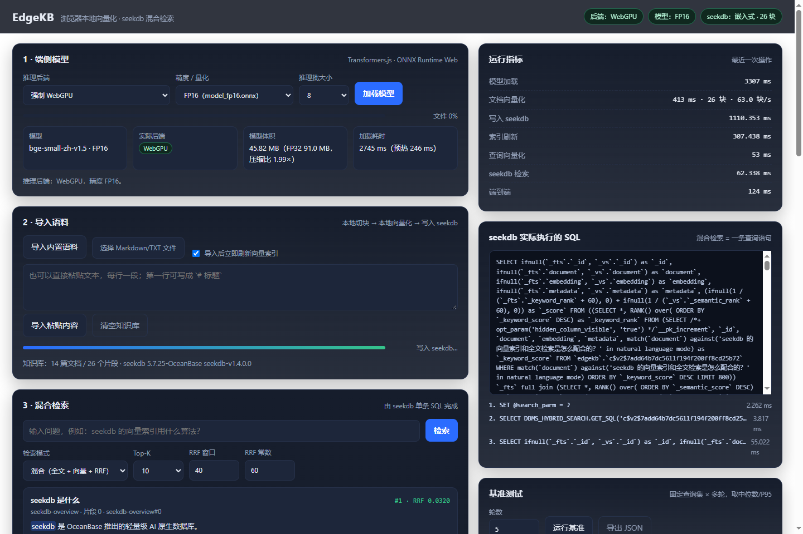

# EdgeKB · 端侧 AI 推理 + seekdb 混合检索

一个**在浏览器里完成文档向量化**、用 **seekdb** 存向量与正文、并由 **seekdb 单条 SQL 完成向量 + 全文混合检索**的迷你个人知识库。

- 端侧推理：Transformers.js（ONNX Runtime Web）在 Web Worker 里跑 `bge-small-zh-v1.5`，WebGPU 优先、自动降级 WASM
- 模型量化：INT8 / FP16 / FP32 三档可切换，实测压缩比 3.88×（INT8）与 1.99×（FP16）
- 数据层：seekdb-js 嵌入式模式（无需单独部署数据库），`FULLTEXT ... WITH PARSER ngram` + `VECTOR ... HNSW/COSINE`
- 混合检索：`collection.hybridSearch()` → seekdb 内部 `DBMS_HYBRID_SEARCH` 生成并执行**一条** SQL，客户端不做两路拼合
- 可复现：内置 16 篇语料 / 32 条评测查询 / 一键基准脚本，所有数字来自提交代码的实际运行



## 实测摘要（同一台机器，32 条查询 × 5 轮中位数）

| 配置 | 模型体积 | 向量化 26 片段 | 混合检索 Recall@5 | seekdb 检索 | 端到端 |
| --- | ---: | ---: | ---: | ---: | ---: |
| WebGPU + FP16 | 45.82 MB | 435 ms（59.8 块/s） | 0.938 | 25.5 ms | 57 ms |
| WebGPU + FP32 | 90.98 MB | 530 ms（49.1 块/s） | 0.938 | 24.2 ms | 55.5 ms |
| WASM + INT8 | 23.42 MB | 5005 ms（5.2 块/s） | 0.938 | 23.7 ms | 49.5 ms |
| WASM + FP32 | 90.98 MB | 8361 ms（3.1 块/s） | 0.938 | 25.5 ms | 63.5 ms |

完整数据（8 档配置 × 3 种检索模式 × 质量与延迟）见 [docs/measurements.md](docs/measurements.md)，方法见 [docs/技术说明.md](docs/技术说明.md)。

## 快速开始

环境要求：**Node.js ≥ 20**、Chrome / Edge 最新版；首次安装需要联网拉取模型与浏览器运行时。

```bash
npm install                 # 只有 seekdb 一个运行时依赖（原生绑定首次运行自动下载）
npm run setup               # 拉取模型（INT8 22.9MB / FP16 45.3MB / FP32 90.5MB）与浏览器运行时
npm start                   # 启动 http://127.0.0.1:5173
```

打开 <http://127.0.0.1:5173>，页面会自动加载模型并连上嵌入式 seekdb：

1. **导入内置语料**（16 篇中文文档 → 26 个片段）或拖入自己的 `.md/.txt`；
2. 在检索框提问，例如「seekdb 的向量索引用什么算法？」；
3. 右侧「运行指标」看每一段耗时，「seekdb 实际执行的 SQL」看数据库真正跑的那条语句。

无浏览器环境时的服务端自检：

```bash
npm run verify              # 健康检查 → 写入 → 刷新 → 混合检索 → 断言新片段可检索
```

### 可选：连接已部署的 seekdb

```bash
SEEKDB_MODE=server SEEKDB_HOST=127.0.0.1 SEEKDB_PORT=2881 SEEKDB_USER=root SEEKDB_PASSWORD= npm start
```

嵌入式模式的数据目录默认 `data/seekdb`（`SEEKDB_PATH` 可改）。同一目录只能被一个进程打开。

## 目录结构

```
stepfun/
├── server/                    # Node 服务：静态资源 + JSON API（不做任何推理）
│   ├── index.mjs              # HTTP 入口、路由、静态文件、COOP/COEP
│   ├── seekdb-store.mjs       # seekdb-js：建库建集合、upsert、索引刷新、混合检索、SQL 埋点
│   └── config.mjs             # 环境变量与默认值
├── web/
│   ├── index.html / styles.css
│   ├── app.js                 # UI、指标、基准、window.__kb 自动化接口
│   ├── embed-worker.js        # 端侧推理 Worker（Transformers.js + ORT Web，WebGPU→WASM 降级）
│   ├── chunker.js             # 本地切块（480 字 + 80 字重叠）
│   └── vendor/                # 由 npm run fetch-vendor 生成（gitignore）
├── data/corpus/               # 16 篇示例文档 + 32 条评测查询（含 12 条改写类难题）
├── models/                    # 由 npm run fetch-models 生成（gitignore）
├── scripts/
│   ├── fetch-models.mjs       # 从 HF 镜像拉模型（固定 revision）
│   ├── fetch-vendor.mjs       # 从 npm tarball 提取浏览器运行时
│   ├── verify.mjs             # 服务端自检
│   ├── bench.mjs              # Edge/Chrome + CDP 自动化基准（8 档配置）
│   ├── report.mjs             # 由基准 JSON 生成 docs/measurements.md
│   └── smoke.mjs              # 单档冒烟（模型加载→导入→检索→截图）
├── bench/results/             # 基准原始数据（提交入库）
├── bench/screenshots/         # 各配置界面截图
└── docs/
    ├── 技术说明.md             # 一页技术说明（模型/量化/端侧/seekdb/优化）
    └── measurements.md        # 由脚本生成的实测数据表
```

## 架构

```
┌──────────────────────── 浏览器（用户设备） ────────────────────────┐
│  主线程 app.js                                                     │
│    · 切块（480/80）  · UI 与指标  · 调用后端 API                    │
│  Worker embed-worker.js                                            │
│    · Transformers.js + ONNX Runtime Web                            │
│    · WebGPU（fp16/fp32）→ 失败自动降级 WASM（int8/fp32）            │
│    · 模型与 ORT wasm 全部本地加载，无任何 CDN / 云端 API            │
└───────────────┬───────────────────────────────────────────────────┘
                │ POST /api/import {chunks:[{text, vector, metadata}]}
                │ POST /api/search {vector, text, mode, topK}
┌───────────────▼──────────────── 本地 Node 服务 ───────────────────┐
│  server/index.mjs  →  seekdb-store.mjs  →  seekdb-js               │
│                                      →  seekdb（嵌入式 / 服务端）  │
│  混合检索：DBMS_HYBRID_SEARCH 生成一条 SQL，在库内做全文+向量+RRF  │
└────────────────────────────────────────────────────────────────────┘
```

关键点：**推理只在浏览器**，服务端只接收向量与正文；**检索只在 seekdb**，服务端不做两路结果合并。

## 与验收项的对应关系

| 验收项 | 实现位置 | 说明 |
| --- | --- | --- |
| 完整流程 | `web/app.js` + `server/index.mjs` | 导入 → 向量化 → 写入 → 检索 → 展示原文 |
| 本地推理 | `web/embed-worker.js` | `env.allowRemoteModels=false`，模型来自 `/models/`，无云端 API |
| 模型量化 | `docs/技术说明.md` §1 | INT8/FP16/FP32 可切换，体积与质量对比见 `docs/measurements.md` |
| 后端与降级 | `embed-worker.js` + `?nogpu=1` | 优先 WebGPU，失败/不可用自动降级 WASM 并在界面提示 |
| seekdb 数据层 | `server/seekdb-store.mjs` | 向量、正文、元数据同表；`hybridSearch` 单条 SQL 在库内完成 |
| 状态与刷新 | `upsert` + `refresh_index()` | 增量导入后刷新，界面显示片段数；`POST /api/reset` 重建集合 |
| 可复现性 | `scripts/*` + `bench/results/` | 一键安装、启动、自检、基准，原始数据入库 |

## 复现基准

```bash
# 1) 启动服务
npm start

# 2) 另开一个终端，启动一个带 CDP 的 Edge（headless 即可）
msedge --headless=new --remote-debugging-port=9222 --user-data-dir=%TEMP%\edgekb about:blank

# 3) 跑 8 档配置（每档 32 查询 × N 轮 × 3 种模式）
npm run bench -- --rounds=5

# 4) 由原始数据生成 Markdown 表
npm run report
```

产物：`bench/results/*.json`（逐条查询结果）、`bench/results/summary.json`（汇总）、`bench/screenshots/*.png`（各配置界面）、`docs/measurements.md`（表格）。

## 已知限制

- 嵌入式 seekdb 单进程独占数据目录，`npm start` 与其它脚本不要同时打开同一个 `SEEKDB_PATH`。
- 评测集只有 32 条查询，指标用于横向对比配置，不代表通用检索质量。
- WASM 后端在 4 线程下并非"批越大越快"（见 `docs/技术说明.md` §4 的实测与解释）。
- 单段超过 480 字符会被硬切，可能出现语义不完整；长文档建议按小节拆分后导入。
